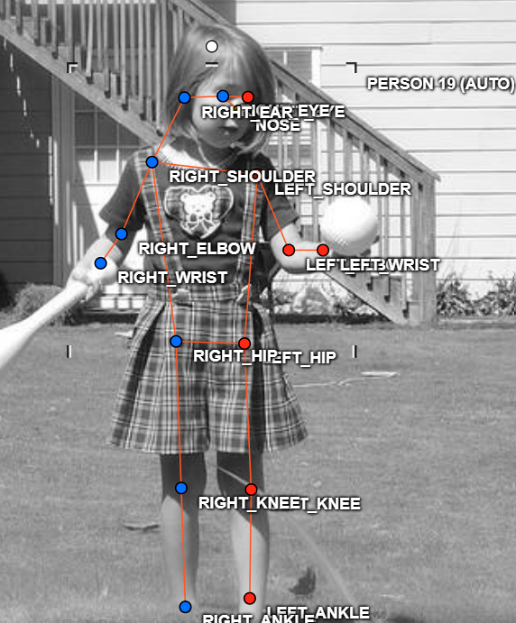
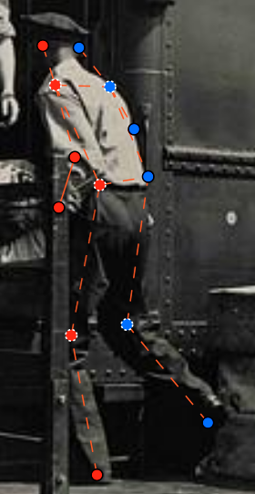
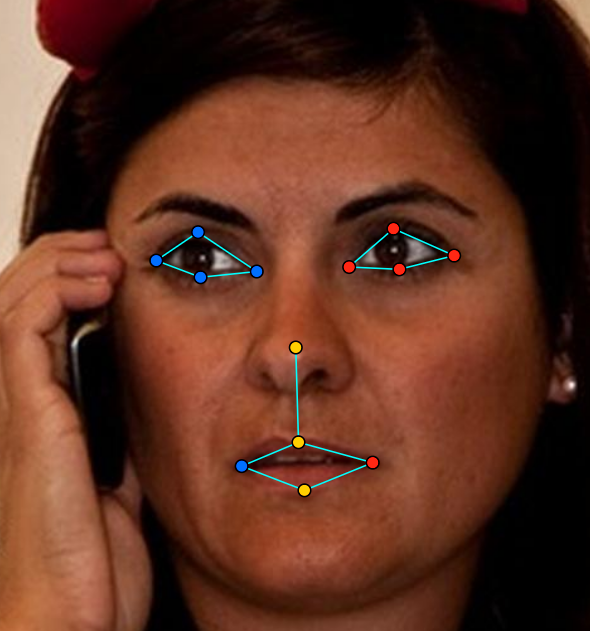
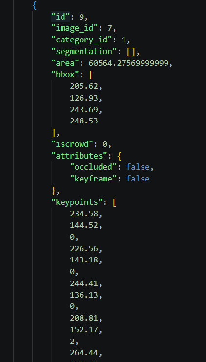

# Báo cáo cá nhân — NguyenTienDat-2A202603289

Dữ liệu: 12 ảnh người COCO (Lin et al., 2014) và 8 ảnh khuôn mặt cắt từ ảnh COCO, chỉ dùng trong lớp.

> **Ghi chú cho người điền:** các mục đã điền sẵn dựa trên file trong repo (`assignment.json`, hai file zip, `labels_d04_keypoint.json`, kết quả `check_submission.py`). Các chỗ `___` / `...` là phần chỉ bạn biết (giờ giấc, thao tác trên CVAT, quá trình làm). **Mục 3, 4, 7 theo `RULES.md` phải do chính bạn viết dựa trên job thật, nên để trống.** Xóa ghi chú này trước khi nộp.

## 0. Thông tin học viên

- Họ tên: Nguyễn Tiến Đạt
- MSSV: 2A202603289
- Email: ___
- Link repository: https://github.com/datpro-sudo/K5-L2B-2A202603289-NguyenTienDat-KeypointPose
- Phiên bản CVAT (Help → About): ___
- Máy: hệ điều hành ___ · RAM ___ GB · chạy CVAT chế độ đầy đủ / lite
- Bộ ảnh (`src/exports/assignment.json` do `lab.py setup` tạo): có
- Giờ bắt đầu: ___
- Giờ kết thúc: ___

## 1. Kiểm tra label (CP0)

Đối chiếu từ file label dùng để tạo project (`src/lab/labels_d04_keypoint.json`) với `src/keypoint_schema.json` và bảng trong `docs/GUIDELINE.md`:

| Label | Kiểu | Số điểm | Tên điểm đúng bảng của lab? | Đúng thứ tự? | Số cạnh |
|---|---|---:|---|---|---:|
| `person` | Skeleton | 17 | Có | Có | 19 |
| `face` | Skeleton | 13 | Có | Có | 13 |

Mẫu `person` dựng theo người quay mặt về camera (các điểm `left_*` nằm bên phải khung mẫu)? ___ (kiểm trên CVAT, Projects → d04-keypoint → Labels)

Cách đổi cờ `occluded` / `outside` cho **một điểm** trên phiên bản CVAT này (một câu):

...

## 2. Số lượng đã gán và thời gian (CP1, CP2)

Số skeleton lấy từ file `NguyenTienDat_persons.zip` / `NguyenTienDat_faces.zip`. Các cột còn lại do bạn điền.

| Nhóm ảnh | Số ảnh | Số skeleton đã gán | Số người dưới 60 px (không gán) | Số poster / gương / màn hình bỏ qua | Thời gian (phút) |
|---|---:|---:|---:|---:|---:|
| `easy` | 5 | 5 | ___ | ___ | ___ |
| `occluded` | 3 | 6 | ___ | ___ | ___ |
| `back` | 2 | 2 | ___ | ___ | ___ |
| `small` | 1 | 2 | ___ | ___ | ___ |
| `crowd` | 1 | 3 | ___ | ___ | ___ |
| `faces` | 8 | 8 | — | ___ | ___ |

Tổng: 12 ảnh người có 18 skeleton `person`; 8 ảnh mặt có 8 skeleton `face`.

- Số ảnh người đã xong ở mốc phút 105: ___ / 10
- Thời gian thực tế (phút): CP1 ___ · CP2 ___ · CP3 ___
- Ảnh tốn thời gian nhất là ảnh nào, vì sao?

...

## 3. Bảng ca khó (CP1, CP2)

*(Tự viết, dựa trên job thật của bạn.)*

| Ảnh | Người / mặt | Điểm | Cờ đã chọn | Phân vân giữa | Lý do chọn |
|---|---|---|---:|---|---|
| `000000542160` | người #1 (cầu thủ số 4, quay lưng) | `nose`, `left_eye`, `right_eye` | 1 | `v = 1` và `v = 0` | Người này đối diện cầu thủ số 2 nên mắt, mũi chắc chắn nằm ở hướng đó, ước lượng chắc nên chọn `v = 1`. Phân vân vì mặt bị che bởi mũ và hướng quay, nhưng hướng nhìn đã rõ nên không chọn `v = 0`. |
| `000000572411` (small) | hai người nhỏ | các điểm của người nhỏ | ___ | khớp và ___ | Ảnh mờ, người chỉ cao vài chục pixel nên khó xác định vị trí từng khớp. |
| `000000311497` | người #2 (cô tennis) | `left_knee`, `right_knee`, `left_ankle`, `right_ankle` | 2 | trái và phải của hai chân | Hai chân vắt chéo khi bước nên khó xác định chân nào là trái, chân nào là phải. Kiểm lại theo hông và hướng bước, giữ nguyên. |

## 4. Bảng tự review (CP3)

*(Tự viết, dựa trên lần review thật của bạn.)*

Đi từ ảnh cuối về ảnh đầu. 5 ảnh người (ít nhất 2 ảnh `back` hoặc `crowd`) và 3 ảnh mặt. Ít nhất 8 dòng, kể cả dòng `ok`. Ghi lỗi trước, sửa sau.

Mã lỗi dùng đúng một trong: `lr_swap`, `vis_flag`, `position`, `missing`, `extra`, `ok`.

| Ảnh | Người / mặt | Điểm | Mã lỗi | Ghi chú | Đã sửa? |
|---|---|---|---|---|---|
| `000000542160` (crowd) | người #1 (cầu thủ số 4, quay lưng) | `nose`, `left_eye`, `right_eye` | `vis_flag` | Mặt không thấy nhưng ba điểm đang để `v = 2`. Đổi sang `v = 1`. | Có |
| `000000521817` (occluded) | người #2 (cậu bé) | vai, hông, chân | `lr_swap` | Thân gán sai hướng so với mắt. Sửa lại vai, hông, chân theo hướng người đúng. | Có |
| `000000508269` (easy) | người #1 | `left_ankle`, `right_ankle` | `ok` | Script cảnh báo ngược phía, nhưng hai cổ chân vắt chéo thật. Giữ nguyên. | Không cần |
| `face_146049` (kính râm) | mặt | bốn điểm mắt sau kính | `vis_flag` | Kính râm tối che mắt nhưng đang để `v = 2`. Đổi sang `v = 1`. | Có |
| `000000311497` (occluded) | người #2 (cô tennis) | `left_knee`, `right_knee`, `left_ankle`, `right_ankle` | `ok` | Script cảnh báo ngược phía, nhưng hai chân vắt chéo thật khi bước. Giữ nguyên. | Không cần |
| `000000043500` (back) | người #1 (quay lưng) | `nose`, `left_eye`, `right_eye`, `left_ear`, `right_ear` (các điểm mặt) | `vis_flag` | Người quay lưng, mặt không thấy nhưng ban đầu để `v = 2`. Đã đổi sang `v = 1`. Các điểm mặt gồm mắt, mũi và tai. | Có |
| `face_345145` (kính trong) | mặt | bốn điểm mắt sau kính | `vis_flag` | Ban đầu để `v = 2`, sau đó đổi sang `v = 1`. Lưu ý: guideline ghi kính trong thì mắt vẫn thấy rõ, `v = 2`. Cần kiểm lại. | Có |
| `face_92028` (mặt nghiêng) | mặt | `nose_tip` | `position` | Ban đầu đặt mũi quá cao. Đã kéo xuống đúng chóp mũi. | Có |

Tổng hợp số lỗi theo mã (8 dòng):

| `lr_swap` | `vis_flag` | `position` | `missing` | `extra` | `ok` |
|---:|---:|---:|---:|---:|---:|
| 1 | 4 | 1 | 0 | 0 | 2 |

Điểm còn phân vân giữa `v = 1` và `v = 0` (ghi cả hai lựa chọn và lý do chọn):

...

## 5. Kiểm file xuất và kết quả tự kiểm (CP4)

Tự kiểm trong file JSON (`annotations/person_keypoints_default.json`). Cột "người / mặt kiểm" ghi theo id annotation trong file:

| File | Người / mặt kiểm (ảnh, thứ tự) | Số phần tử `keypoints` | Điểm `outside` ra `v = 0`, `occluded` ra `v = 1`? | `num_keypoints` khớp? |
|---|---|---:|---|---|
| `NguyenTienDat_persons.zip` | `000000043500.jpg`, annotation id 1 | 51 | 4 điểm `v = 0`; ___ điểm `v = 1` (kiểm lại trên file xuất mới) | Có (13 = số điểm `v > 0`) |
| `NguyenTienDat_persons.zip` | `000000375535.jpg`, annotation id 6 | 51 | 3 điểm `v = 0`; ___ điểm `v = 1` (kiểm lại trên file xuất mới) | Có (14 = số điểm `v > 0`) |
| `NguyenTienDat_faces.zip` | `face_141135.jpg` | 39 | ___ điểm `v = 2`, ___ điểm `v = 1` (kiểm lại trên file xuất mới); không có điểm `v = 0` | Có (13) |

Trên toàn bộ file: `num_keypoints` khớp số điểm `v > 0` ở cả 18 skeleton người và 8 skeleton mặt.

Sau khi xuất, CVAT ghi `outside` thành `v = 0` (25 điểm). Với `occluded`: sau khi sửa và xuất lại, file có 20 điểm `v = 1` ở task người và 12 điểm `v = 1` ở task mặt, nên CVAT ghi `occluded` thành `v = 1`. Tọa độ của điểm `outside` trong file là **tọa độ cũ** (13 skeleton có điểm `v = 0` vẫn mang tọa độ khác 0, đúng như ghi chú của script).

Hai job đã chuyển sang completed trên CVAT? ___

Phần **TÓM TẮT** in ra từ `src/check_submission.py`:

```text
- File person: NguyenTienDat_persons.zip
  Số ảnh: 12 · số skeleton `person`: 18 · mỗi annotation 51 số
  Skeleton theo ảnh: 000000043500=1, 000000156069=1, 000000164659=1, 000000311497=2, 000000375535=2, 000000508269=1, 000000515309=1, 000000521817=2, 000000525227=1, 000000542160=3, 000000564304=1, 000000572411=2
  Cờ v: v=2 261 (85%) · v=1 20 (7%) · v=0 25 (8%)
  num_keypoints trung bình: 15.6
- File face: NguyenTienDat_faces.zip
  Số ảnh: 8 · số skeleton `face`: 8 · mỗi annotation 39 số
  Skeleton theo ảnh: face_141135=1, face_146049=1, face_264124=1, face_345145=1, face_359139=1, face_38721=1, face_442231=1, face_92028=1
  Cờ v: v=2 92 (88%) · v=1 12 (12%) · v=0 0 (0%)
  num_keypoints trung bình: 13.0
- Ghi chú: 25 điểm v = 0 vẫn mang tọa độ cũ (CVAT 2.x xuất như vậy; chuẩn COCO ghi 0, 0). Không phải lỗi: điểm v = 0 bị bỏ qua khi huấn luyện và khi chấm.
- Số [LỖI]: 0 · số [CẢNH BÁO]: 4
Kết quả: ĐẠT (đọc lại từng cảnh báo ở trên)
```

Các `[CẢNH BÁO]` còn giữ nguyên và lý do (bạn tự điền lý do sau khi mở lại từng ca trên CVAT; nếu đúng là lỗi thì sửa rồi xuất lại):

| Ảnh | Cảnh báo của script | Lý do giữ nguyên / đã sửa |
|---|---|---|
| `000000311497.jpg` #2 | cặp `knee`, `ankle` nằm ngược phía so với các cặp còn lại | Hai chân của cô vận động viên đang vắt chéo thật khi bước đi nên giữ nguyên, không sửa. |
| `000000508269.jpg` #1 | cặp `ankle` nằm ngược phía so với các cặp còn lại | Hai cổ chân vắt chéo thật nên giữ nguyên, không sửa. |
| `000000521817.jpg` #2 | cặp `eye` nằm ngược phía so với các cặp còn lại | Mắt gán theo kiểu quay mặt về camera nhưng vai, hông, chân gán theo hướng khác. Đã sửa lại vai, hông, chân theo hướng người đúng. |
| `000000542160.jpg` #1 | thấy rõ mũi và hai mắt (`v = 2`) nhưng các điểm `left` nằm bên TRÁI ảnh | Người này quay lưng nên vị trí `left` bên trái ảnh là đúng. Lỗi nằm ở cờ: mũi và hai mắt không thấy nhưng để `v = 2`. Đã đổi sang `v = 1`: người này đối diện cầu thủ số 2 nên mũi và mắt chắc chắn nằm ở hướng đó, ước lượng chắc chắn nên chọn `v = 1`. |

## 6. Ảnh chụp màn hình

*(Tự chụp từ CVAT của bạn, lưu đúng tên vào `report/individual/images/`.)*

1. Label `person` trong label constructor (đủ 17 điểm có tên):

   

2. Một người quay lưng đã gán, cờ đã đặt:

   

3. Một khuôn mặt đã gán 13 điểm, phóng to vùng mắt:

   

4. Một đoạn JSON xuất của một người:

   

Nguồn ảnh: COCO 2017.

## 7. Tự đánh giá

*(Tự viết.)*

1. Lỗi bạn mắc nhiều nhất hôm nay, và cách bạn sẽ tránh ở dự án thật:

   ...

2. Một quy tắc bạn đề xuất thêm vào guideline (kèm ảnh ví dụ nếu có):

   ...

3. Nhãn của bạn đi vào model ở đâu? Chọn một lỗi bạn đã sửa và nói nó sẽ làm model học sai thế nào (heatmap, trọng số trong loss, hay bước lật ảnh):

   ...

## 8. Khó khăn và lỗi kỹ thuật

...

## 9. Tài liệu tham khảo và công cụ AI đã dùng

- Tài liệu lab: `README.md`, `RULES.md`, `RUBRIC.md`, `CHECKPOINTS.md`, `docs/GUIDELINE.md`, `docs/COCO_KEYPOINTS.md` trong repo đề bài.
- Lin et al., 2014, *Microsoft COCO: Common Objects in Context*.
- Claude (Anthropic): giải thích các trường của công cụ AI Tools / Detectors trong CVAT, nhận xét một ảnh skeleton, đọc repo và điền các mục kỹ thuật của báo cáo (mục 0, 1, 2, 5, 9) từ file trong repo. Không dùng để viết mục 3, 4, 7. ___ (bổ sung thật thà nếu có dùng công cụ khác)
